# SOC

## First Week at Cyber Career Fair Bootcamp

---

## The Required Environment

The table below shows the details of each host on the network.

| | VM 1 | VM 2 | VM 3 |
|---|---|---|---|
| **Hostname** | windows | admin | kali |
| **OS** | Windows | Ubuntu | Kali Linux |
| **IP Address** | 192.169.1.11 | 192.169.1.8 | 192.169.1.10 |
| **MAC Address** | 08:00:27:83:94:08 | 08:00:27:38:28:88 | 08:00:27:5a:87:bc |
| **Role** | Windows endpoint | Organisational server | Security Testing/Admin Machine |
| **Network Adapter** | Ethernet | enp0s3 | eth0 |
| **Default Gateway** | 192.169.1.1 | 192.169.1.1 | 192.169.1.1 |
| **DNS** | 1.1.1.1 | 1.1.1.1 | 1.1.1.1 |

These VMs are connected via **NAT Network**, and the DHCP server is at **192.169.1.2**. We chose NAT Network as a team because it allows the machines to communicate with each other and access the internet, unlike Host-Only.

### Network Diagram

```
                      [ Internet ]
                           |
                           |
                 [ Router 192.169.1.1 ]
                    /      |      \
                   /       |       \
                  /        |        \
  [ VM 1: windows ]  [ VM 2: admin ]  [ VM 3: kali ]
    192.169.1.11       192.169.1.8       192.169.1.10
```

### Connectivity Verification

I verified communication between the VMs by **pinging the Ubuntu server from the Windows endpoint** and by **logging into the server over SSH from the security admin machine (Kali)**.

```bash
ping 192.169.1.8
ssh server@192.169.1.8 -p 22
```

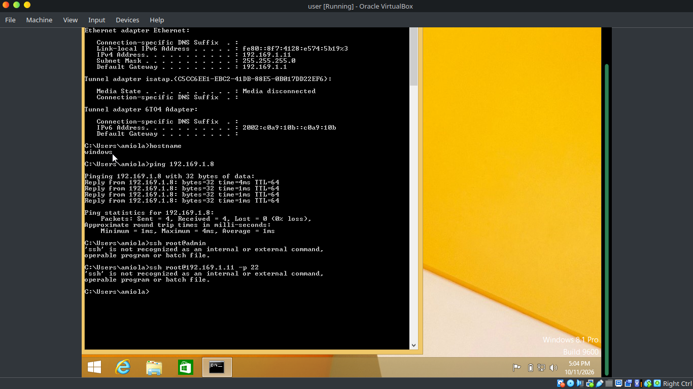

*Evidence 3: Windows hostname and ping to 192.169.1.8*

---

## Windows Baseline

**Hostname:** windows
**Windows version:** Windows 8.1 Pro

**IP configuration:**
- IP address: 192.169.1.11
- MAC address: 08:00:27:83:94:08
- Default gateway: 192.169.1.1

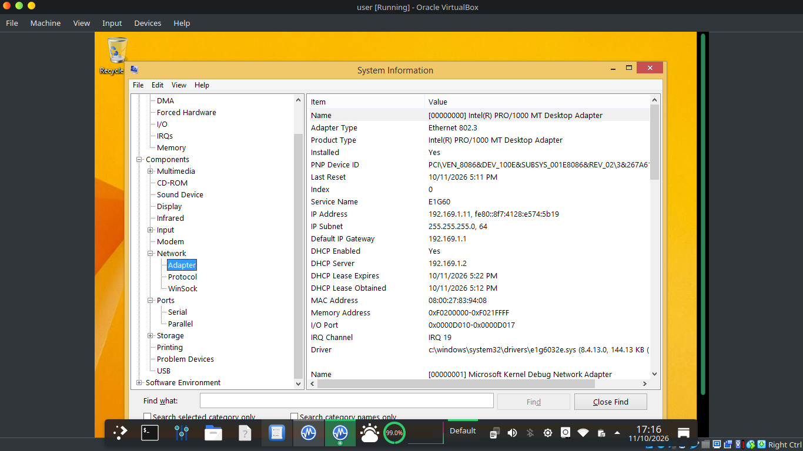

*Evidence 1: Windows network adapter details (IP, MAC, gateway)*

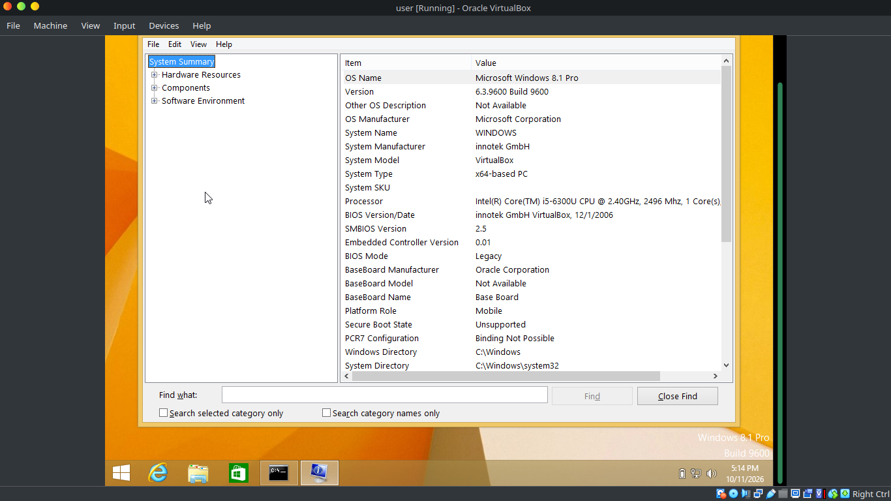

*Evidence 2: Windows system summary*

### Running Processes

I noted the following running processes using Task Manager **(Ctrl + Shift + Esc)**:

- **explorer.exe** (PID 2464): From the name, I deduced it was a running instance of File Explorer. It looked suspicious since I had not opened File Explorer.
- **taskmgr.exe** (PID 2792): This process was started by me when I opened Task Manager. It would be suspicious if it consumed more than 10% of system resources.
- **spoolsv.exe** (PID 316): This process relates to printing services. It runs because it starts at boot. If it runs without being enabled at boot or consumes high system resources, it raises a suspicious flag.

---

## Linux Administration

I created two new users, **alice** and **bob**, on the organisation server running Ubuntu, using the `useradd` command, and set their passwords with `passwd`. I created a new group, **soc**, and made both alice and bob members of it.

I created a new test file named `testfile` in `/home/test`. Initially, the superuser owned the file, so I changed its ownership using `chown`:

```bash
sudo chown alice /home/test
```

I then changed the file's permissions to `rwxrwx---` (770). With this setting, only alice and members of the soc group could read, write and execute the file. bob and other (future) users were excluded.

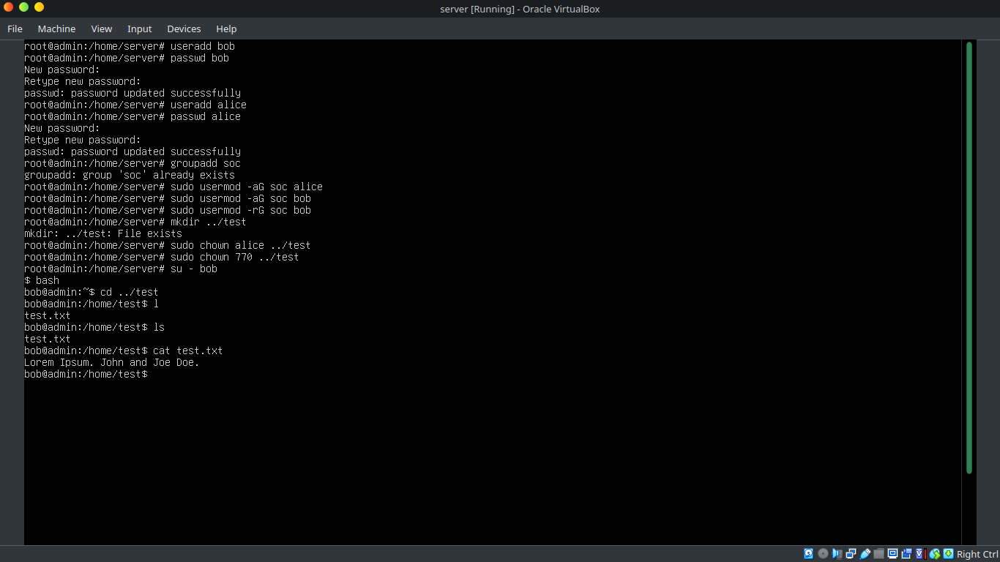

*Evidence 4: Creating users, setting passwords, group membership and file ownership*

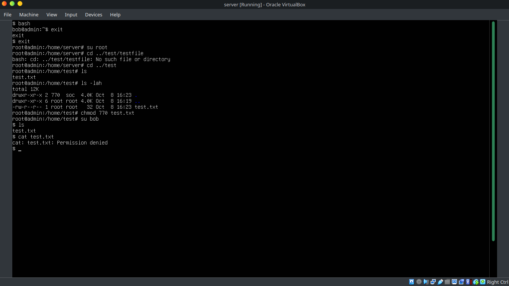

*Evidence 5: Permission change and access test (bob denied)*

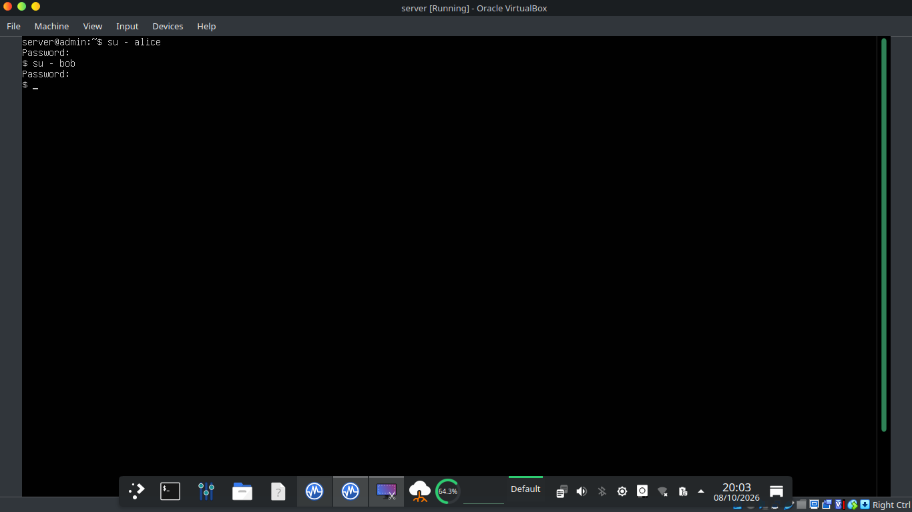

*Evidence 6: Switching between alice and bob accounts*

### Login Testing

On rebooting the Ubuntu server, I performed both normal and controlled failed logins.

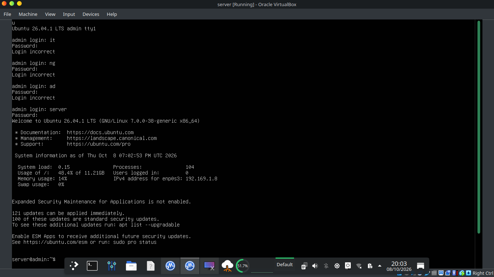

*Evidence 7: Failed logins followed by a successful login*

### Log Evidence

User creation and login events are stored in `/var/log/auth.log` and `/var/log/syslog`. These logs record the timestamp of each event.

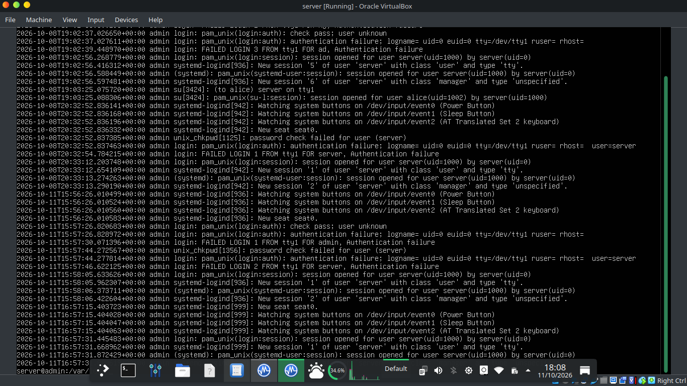

*Evidence 8: `/var/log/auth.log` entries for login attempts*

### Windows Event Viewer

The Windows Event Viewer was useful for locating relevant evidence.

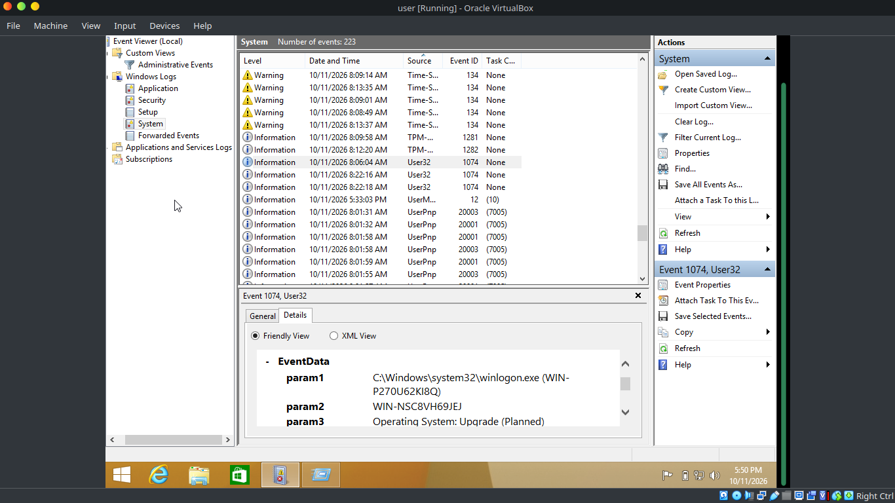

*Evidence 9: Windows Event Viewer, System log*

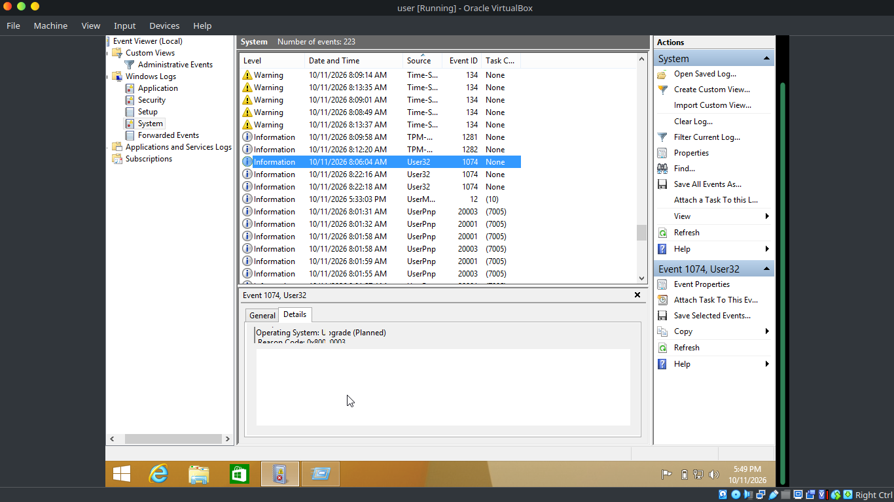

*Evidence 10: Event 1074 details*

---

## Network Baseline

While I was pinging the security admin machine from the Ubuntu server, Wireshark captured all packets traveling over the 192.169.1.0 network.

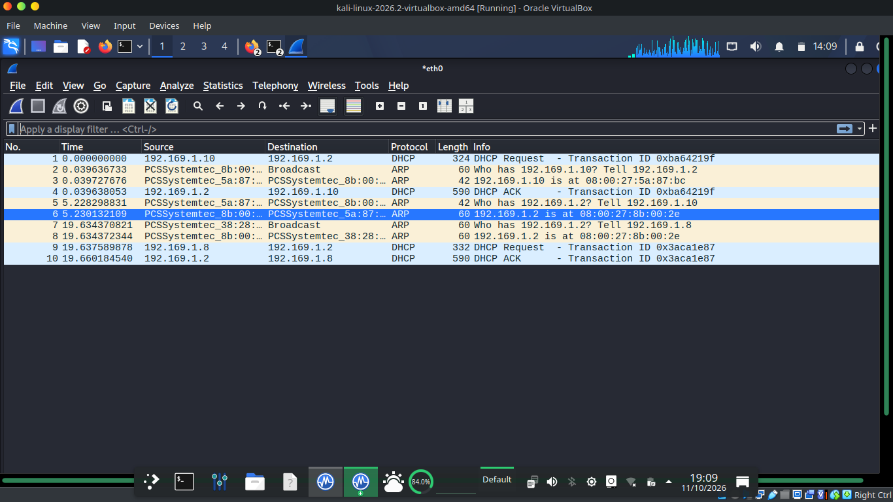

*Evidence 11: DHCP exchange captured in Wireshark*

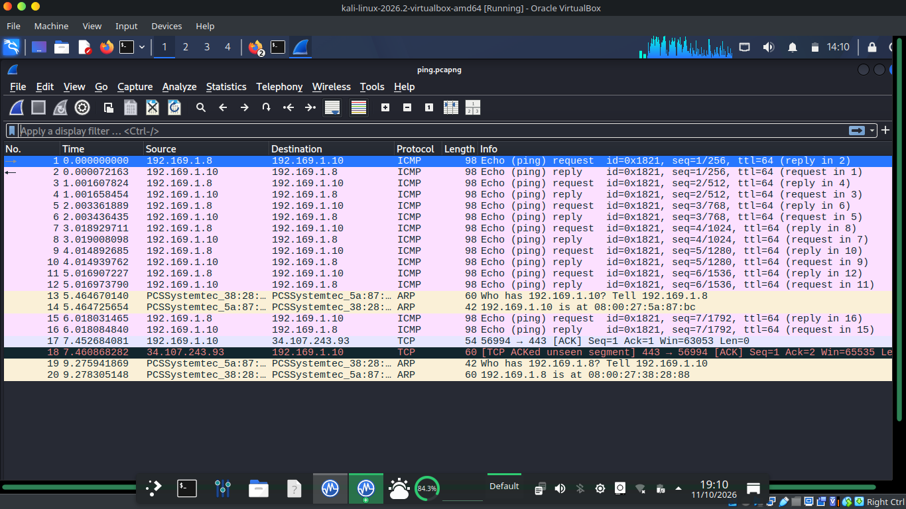

*Evidence 12: ICMP echo requests and replies between 192.169.1.8 and 192.169.1.10*

I was particularly interested in the **8th packet**. It contained an echo (ping) reply from **192.169.1.10** (source) to **192.169.1.8** (destination). The ping command uses the Internet Control Message Protocol (ICMP), which generated this activity.

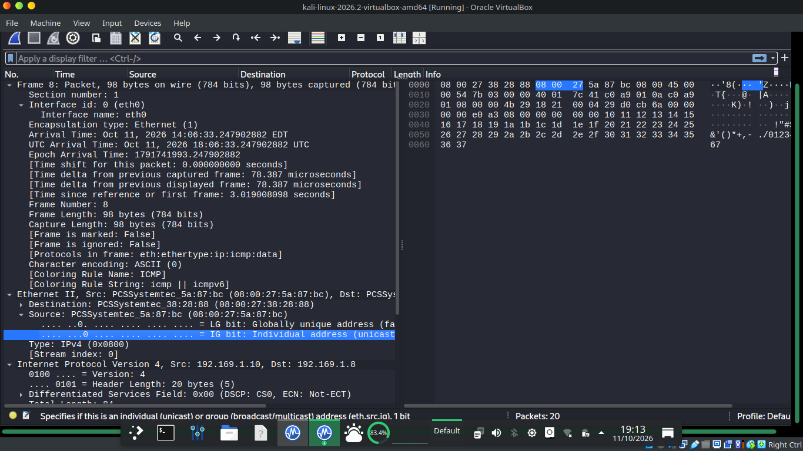

*Evidence 13: Frame 8, ICMP echo reply details*

---

## Controlled Security Activity

I performed a basic port scan against the organisation server (**192.169.1.8**) using nmap. The scan found **port 22 (SSH)** open on the server.

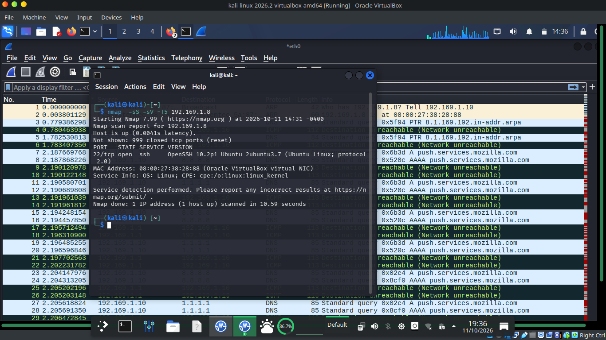

*Evidence 14: Nmap scan results for 192.169.1.8*

---

## Evidence Index

| Evidence | Description | Section |
|---|---|---|
| 1 | Windows network adapter details | Windows Baseline |
| 2 | Windows system summary | Windows Baseline |
| 3 | Hostname and ping to 192.169.1.8 | Connectivity Verification |
| 4 | Creating users, group, and file ownership | Linux Administration |
| 5 | Permission change and access test | Linux Administration |
| 6 | Switching between alice and bob | Linux Administration |
| 7 | Failed logins and successful login | Login Testing |
| 8 | `/var/log/auth.log` entries | Log Evidence |
| 9 | Event Viewer, System log | Windows Event Viewer |
| 10 | Event 1074 details | Windows Event Viewer |
| 11 | DHCP exchange in Wireshark | Network Baseline |
| 12 | ICMP echo requests and replies | Network Baseline |
| 13 | Frame 8, ICMP echo reply | Network Baseline |
| 14 | Nmap scan of 192.169.1.8 | Controlled Security Activity |
